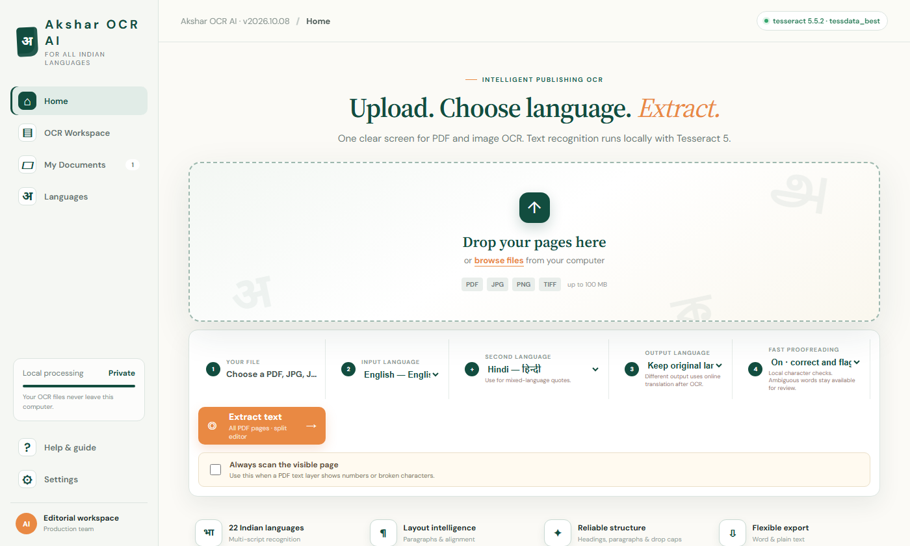
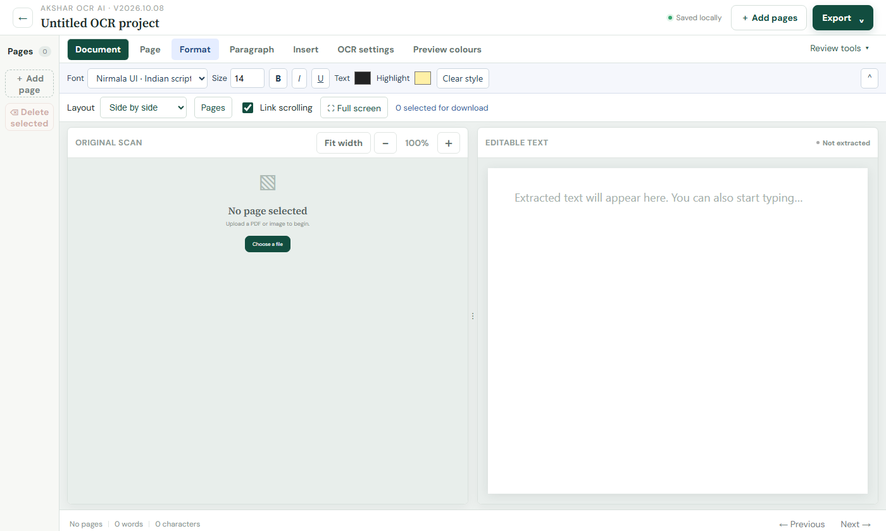
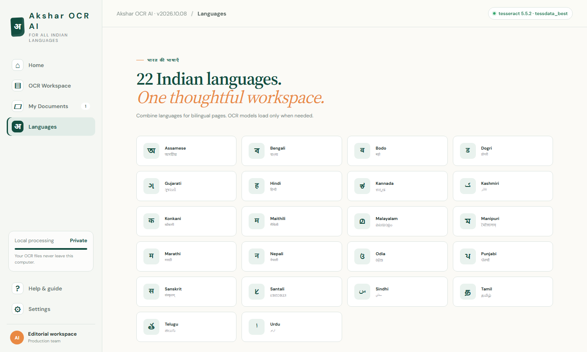
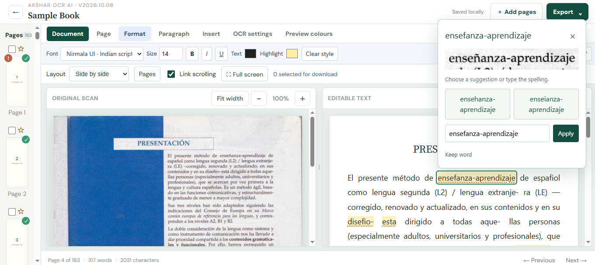
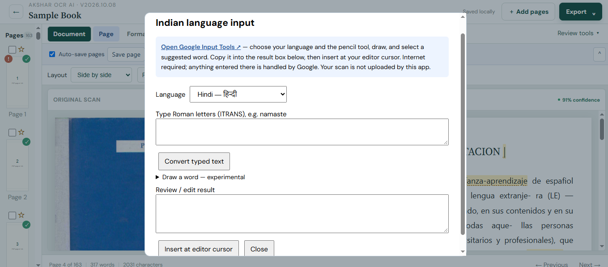
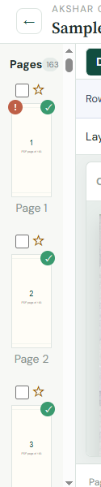
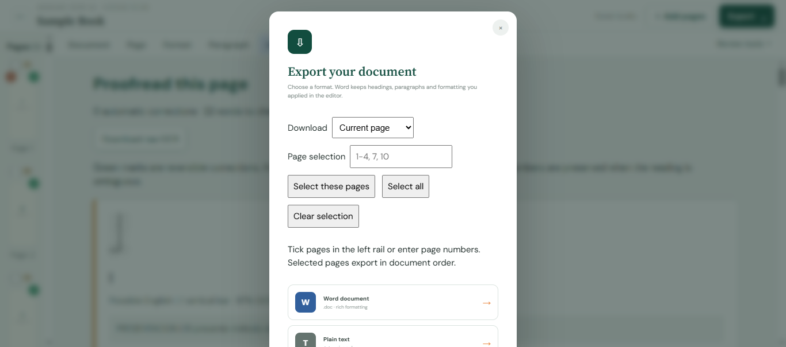

<div align="center">

<h1>🔤 Akshar OCR AI</h1>
<p><strong>Offline OCR for all 22 Indian constitutional languages + English — powered by Tesseract 5 & AI Kosh datasets</strong></p>

<p>
  <a href="https://github.com/UjjwalDS/akshar-ocr-ai/releases/latest">
    
  </a>
  
  
  
  
  
</p>

</div>

---

## 📖 Table of Contents
- [✨ What is Akshar OCR AI?](#-what-is-akshar-ocr-ai)
- [🚀 Features](#-features)
- [🌐 Supported Languages — All 22 + English](#-supported-languages--all-22--english)
- [📸 Screenshots](#-screenshots)
- [⬇️ Download & Quick Start](#️-download--quick-start)
- [🧠 How It Works — OCR Pipeline](#-how-it-works--ocr-pipeline)
- [🔌 Tech Stack](#-tech-stack)
- [🔏 Privacy & Internet](#-privacy--internet)
- [⚙️ For Developers](#️-for-developers)
- [📝 Accuracy Notice](#-accuracy-notice)
- [📜 Third-Party Credits](#-third-party-credits)
- [🙌 Acknowledgements](#-acknowledgements)
- [📃 License](#-license)

---

## ✨ What is Akshar OCR AI?

**Akshar OCR AI** is a powerful, fully offline desktop OCR tool purpose-built for **digitizing Indian language documents**. It extracts text from scanned PDFs, photos, and images with a rich built-in editor, live translation, word suggestions, and an original-vs-extracted side-by-side compare view — all running privately on your Windows PC.

> Built with ❤️ using **Tesseract OCR 5.5.2 + tessdata_best**, training data from **IndiaAI AIKosh**, and open Indian language datasets. No cloud. No upload. No subscription. **Your scans never leave your computer.**

---

## 🚀 Features

### 📄 OCR & Extraction
- 📥 Upload **PDF, JPG, JPEG, PNG, TIFF, WEBP, BMP** files (up to 100 MB)
- 🌍 **All 22 Indian constitutional languages + English** — choose one or two for bilingual pages
- ⚡ **Background extraction** — edit completed pages while remaining pages still process
- 🔲 **Read Scan Region** — drag a rectangle on the scan to OCR just that area
- 🔁 **Re-read a page** in a different language anytime without losing edits
- ⏸️ **Pause / Stop** after active pages finish; queue runs safely in the background
- 📄 **Automatic deskew** — corrects tilted scans before recognition
- 🔀 Handles PDFs with embedded text layers — auto-detects and skips bad layers

### 🌐 Built-in Translation
- 🔤 **Translate extracted text** into any of the 22 Indian languages or English
- Works on the current page or all pages via `/api/translate`
- Preserves paragraph breaks and sentence order during translation
- Powered by a local Python backend — reports the translation engine used
- ⚠️ Optional feature — uses an external translation service; not required for OCR

### ✏️ Rich Text Editor
- **Word-style ribbon** — Page, Format, Paragraph, Insert, OCR Settings, Preview Colours tabs
- Bold, italic, underline, strikethrough, text colour, highlight colour
- Alignment (left, centre, right, justify), lists, drop caps
- **Editable tables** — insert, navigate, and format tables within the editor
- **Find & Replace** — fix repeated OCR errors across the current page
- **Live page statistics** — words, characters, and paragraphs updated as you type
- Undo / Redo, copy clean Unicode text, remove legacy bold markup
- Jump to **Next review page** (lowest-confidence result)

### 🖼️ Side-by-Side Compare Workspace
- **4 layout modes**: side-by-side, top/bottom, original-only, text-only
- Adjustable split divider — drag to resize panes
- **Linked or independent scrolling** — toggle per session
- Scan zoom control and full-screen mode
- **Click any OCR word** in the editor → highlights its exact source region on the scan
- **Preview Colours** — customise cursor-highlight colour, opacity, and background

### 🔍 Smart Proofreading
- Fast, local **glyph confusion checks**: i/l/1, 0/O, rn/m and other common OCR errors
- Up to **4 image-based alternative candidates** per flagged word
- Compare the scan crop, pick a suggestion, keep the original, undo, or type your own fix
- **Hindi punctuation flagging** — quotation marks, apostrophes, asterisks flagged for manual review (never auto-applied)
- **OCR confidence badge** per page — low-confidence pages flagged for proofreading priority
- "Next review page" button to jump straight to the weakest results

### 📝 Indian Language Typing & Drawing
- **ITRANS phonetic input** — type Roman letters, get Devanagari / Tamil / Telugu / etc. output
- **Google Input Tools integration** — open externally for handwriting input, paste back results
- **Experimental local drawing pad** — draw characters for recognition (accuracy varies)
- Script-aware editor fonts for Tamil and Telugu
- Phonetic transliteration via Sanscript.js for all 22 Indian scripts

### 💾 Save, Resume & Export
- **Auto-save by default** (page-safe) — Ctrl+S for explicit manual save
- Keeps **2 most recent projects** — fully resumable including source images, edits, and queue state
- **Bookmarks** — star any page and jump back via the Bookmarks menu
- **Chapter / section naming** per page and printed page number tracking
- **Export options**: Word (.doc with formatting), Plain Text (.txt)
- Export the **current page, selected pages, or all pages** in one step
- Stable page IDs prevent cross-page text replacement during concurrent saves

### 📊 Accuracy Model Lab (built in)
- Transparent status panel showing: Tesseract 5.5.2 (Active), proofreading model (Local/Fast), PaddleOCR PP-OCRv5 (Evaluated for future), IndiaAI AIKosh (Data Source)
- Engine health check on startup — falls back to Browser OCR if Python backend is unavailable
- OCR confidence score shown per page

---

## 🌐 Supported Languages — All 22 + English

All 22 official Indian constitutional languages are supported. English and Hindi have the highest tested accuracy; all others share the same OCR and review interface.

| # | Language | Native Script | Tesseract Code | Script / Model |
|---|---|---|---|---|
| 1 | Assamese | অসমীয়া | `asm` | Bengali script |
| 2 | Bengali | বাংলা | `ben` | Bengali script |
| 3 | Bodo | बड़ो | `brx` | Devanagari script |
| 4 | Dogri | डोगरी | `doi` | Devanagari script |
| 5 | Gujarati | ગુજરાતી | `guj` | Gujarati script |
| 6 | **Hindi** ⭐ | हिन्दी | `hin` | Devanagari — best accuracy |
| 7 | Kannada | ಕನ್ನಡ | `kan` | Kannada script |
| 8 | Kashmiri | کٲشُر | `kas` | Urdu / Nastaliq script |
| 9 | Konkani | कोंकणी | `gom` | Devanagari script |
| 10 | Maithili | मैथिली | `mai` | Tirhuta / Devanagari |
| 11 | Malayalam | മലയാളം | `mal` | Malayalam script |
| 12 | Manipuri | মেইতেই | `mni` | Meitei Mayek script |
| 13 | Marathi | मराठी | `mar` | Devanagari script |
| 14 | Nepali | नेपाली | `nep` | Devanagari script |
| 15 | Odia | ଓଡ଼ିଆ | `ori` | Odia script |
| 16 | Punjabi | ਪੰਜਾਬੀ | `pan` | Gurmukhi script |
| 17 | Sanskrit | संस्कृतम् | `san` | Devanagari script |
| 18 | Santali | ᱥᱟᱱᱛᱟᱲᱤ | `sat` | Ol Chiki script |
| 19 | Sindhi | سنڌي | `snd` | Urdu script |
| 20 | Tamil ⭐ | தமிழ் | `tam` | Tamil — dedicated model |
| 21 | Telugu ⭐ | తెలుగు | `tel` | Telugu — dedicated model |
| 22 | Urdu | اردو | `urd` | Urdu / Nastaliq script |
| + | **English** ⭐ | English | `eng` | Latin — best accuracy |

> ⭐ Bundled offline — no download needed. All other language models download on first use and are cached locally.

---

## 📸 Screenshots

> 📌 *Add your real screenshots to the `screenshots/` folder and they'll appear here*

| Home & Upload | OCR Workspace — Side-by-Side Compare |
|:---:|:---:|
|  |  |

| Rich Text Editor with Ribbon | Translation — Any of 23 Languages |
|:---:|:---:|
|  |  |

| Word Suggestions & Proofreading | Indian Language Typing (ITRANS) |
|:---:|:---:|
|  |  |

| Bookmarks & Page Navigation | Export Options |
|:---:|:---:|
|  |  |

---

## ⬇️ Download & Quick Start

### System Requirements

| | |
|---|---|
| **OS** | Windows 10 / 11, 64-bit only |
| **RAM** | 8 GB recommended (more for high-resolution or large PDFs) |
| **Disk** | 1 GB+ free space |
| **Internet** | Not required for OCR *(first-time language model downloads are cached locally)* |

### Steps

1. Go to 👉 **[Releases](https://github.com/UjjwalDS/akshar-ocr-ai/releases/latest)**
2. Download `Akshar-OCR-AI-Windows.zip`
3. Right-click the ZIP → **Extract All**
4. Open the extracted folder → double-click **`Akshar-OCR-AI.exe`**
5. Your browser opens at `http://127.0.0.1:8890/` automatically
6. Upload a PDF or image → pick your language → click **Extract text**
7. Edit, translate, proofread, and export!

> ✅ No Python, pip, or Tesseract installation needed — everything is bundled.

> ⚠️ Windows SmartScreen may warn on first run (executable is unsigned). Click **More info → Run anyway**. Verify the file integrity using `SHA256SUMS.txt`.

---

## 🧠 How It Works — OCR Pipeline

When you click **Extract Text**, Akshar runs a 4-step pipeline:

```
📄 Upload
   │
   ▼
1. Deskew          — Correct page tilt automatically
   │
   ▼
2. Recognize       — Tesseract 5.5.2 + tessdata_best models run OCR
   │
   ▼
3. Rebuild layout  — Reconstruct paragraph structure, spacing, chapters
   │
   ▼
4. Quality check   — Glyph confusion checks, Hindi punctuation flags, confidence scoring
   │
   ▼
✅ Editable text in Compare workspace
```

All four steps run **locally** via a Python/Tesseract backend. If the backend is unavailable, the app falls back to Browser OCR (Tesseract.js) automatically.

---

## 🔌 Tech Stack

| Component | Technology | Notes |
|---|---|---|
| **OCR Engine** | Tesseract OCR 5.5.2 + tessdata_best | Runs via Python backend |
| **Browser OCR fallback** | Tesseract.js 7.0.0 | Runs in-browser if backend unavailable |
| **PDF rendering** | PDF.js 5.6.205 | Auto-detects embedded text layers |
| **Translation** | `/api/translate` Python endpoint | External service, opt-in only |
| **Transliteration** | Sanscript.js 1.3.3 | ITRANS → Indian scripts, offline |
| **Word suggestions** | wordfreq 3.1.1 frequency data | English frequency list, local |
| **Compare workspace** | `comparison.js` | Side-by-side OCR word mapping |
| **Rich text editor** | `editing-desk.js` | Word-style ribbon, tables, formatting |
| **Compact UI** | `compact-workspace.js` | Mobile-responsive toolbar |
| **Runtime** | Python (bundled via PyInstaller) | No separate install needed |
| **Training data source** | IndiaAI AIKosh | Indian language datasets |

---

## 🔏 Privacy & Internet

| Feature | Online / Offline |
|---|---|
| OCR extraction | ✅ 100% offline (Python/Tesseract) |
| Browser OCR fallback | ✅ 100% offline (Tesseract.js) |
| Word suggestions | ✅ 100% offline |
| Proofreading / glyph checks | ✅ 100% offline |
| Project save / resume | ✅ 100% local (`%LOCALAPPDATA%\AksharOCRAI`) |
| Additional language models | 🌐 First-time download only, then cached |
| Google Fonts (UI fonts) | 🌐 Loaded from Google on first use |
| Optional translation | 🌐 External service — do not use with confidential documents |
| Google Input Tools (handwriting) | 🌐 External — handled on Google's site |

> **Your scans and documents are never uploaded.** OCR, proofreading, and word suggestions run entirely on your machine.

---

## ⚙️ For Developers

### Running from Source

```bash
# Requirements: Python 3.10+, Windows
pip install -r requirements.txt
python server.py
# Visit http://127.0.0.1:8890/
```

Provide `ocr-engine/tesseract.exe` and models in `tessdata/`, or install Tesseract separately and let models download on demand.

### Building the EXE

```bash
pip install pyinstaller
pyinstaller --noconfirm Akshar-OCR-AI.spec
# Output in dist/
```

### API Endpoints (local server)

| Endpoint | Method | Purpose |
|---|---|---|
| `/api/health` | GET | Engine status, translation readiness |
| `/api/ocr` | POST | Extract text from a page (deskew + recognize + rebuild) |
| `/api/translate` | POST | Translate extracted text between languages |
| `/api/projects` | GET | List saved projects |
| `/api/project?id=` | GET | Load a specific project |
| `/api/project-save` | POST | Save project state |
| `/api/project-delete` | POST | Delete a saved project |
| `/api/project-source?id=` | GET | Retrieve original source files |

### Project Data Storage
```
%LOCALAPPDATA%\AksharOCRAI\
├── projects-v1\          # Up to 2 saved projects (JSON + source files)
└── tessdata\             # Downloaded language model cache
    ├── eng.traineddata
    ├── hin.traineddata
    ├── Devanagari.traineddata
    └── ... (other languages cached on first use)
```

---

## 📝 Accuracy Notice

> **95% average accuracy (English/Hindi) is a target, not an independently benchmarked result.**

Accuracy depends heavily on scan quality, font style, document layout, and language. **Always proofread before publishing.** OCR confidence scores are indicators, not measured accuracy percentages.

**Tips for best results:**
- Use upright, high-resolution, clear scans
- Select only the languages actually present on the page
- Use **"Always scan the visible page"** if a PDF's embedded text layer produces numbers or garbled output
- Use **Read Scan Region** to re-OCR specific difficult areas

---

## 📜 Third-Party Credits

| Library | Version | License |
|---|---|---|
| [Tesseract OCR](https://github.com/tesseract-ocr/tesseract) | 5.5.2 | Apache 2.0 |
| [Tesseract.js](https://github.com/naptha/tesseract.js) | 7.0.0 | Apache 2.0 |
| [PDF.js](https://github.com/mozilla/pdf.js) | 5.6.205 | Apache 2.0 |
| [Sanscript.js](https://github.com/indic-transliteration/sanscript.js) | 1.3.3 | MIT |
| [wordfreq](https://github.com/rspeer/wordfreq) by Robyn Speer | 3.1.1 | Apache 2.0 (code) / CC BY-SA 4.0 (data) |
| [Pillow](https://github.com/python-pillow/Pillow) | — | HPND |
| [Python](https://www.python.org/) | — | PSF License |

Full license texts are in the `licenses/` folder and `THIRD_PARTY_NOTICES.md`.

---

## 🙌 Acknowledgements

- **[IndiaAI AIKosh](https://aikosh.indiaai.gov.in/home/)** — dataset and model catalogue for Indian-language training and evaluation assets
- **[Tesseract OCR](https://github.com/tesseract-ocr/tesseract)** — the core OCR engine powering every extraction
- **[AI4Bharat / IIT Madras](https://ai4bharat.iitm.ac.in/)** — Indian language NLP resources and research
- **[tessdata_best](https://github.com/tesseract-ocr/tessdata_best)** — high-accuracy trained model weights
- **[PaddleOCR](https://github.com/PaddlePaddle/PaddleOCR)** — evaluated as next-generation engine for future releases
- All open-source contributors whose libraries made this possible

---

## 📃 License

The **source code** of Akshar OCR AI is released under the **[Apache License 2.0](LICENSE)**.

Third-party components retain their respective licenses — see [`THIRD_PARTY_NOTICES.md`](THIRD_PARTY_NOTICES.md).

---

<div align="center">
  <p>Made with ❤️ for Indian language digitization</p>
  <p>⭐ If this project helped you, please give it a star on GitHub!</p>
  <p><a href="https://github.com/UjjwalDS/akshar-ocr-ai/releases/latest">⬇️ Download Latest Release</a></p>
</div>
