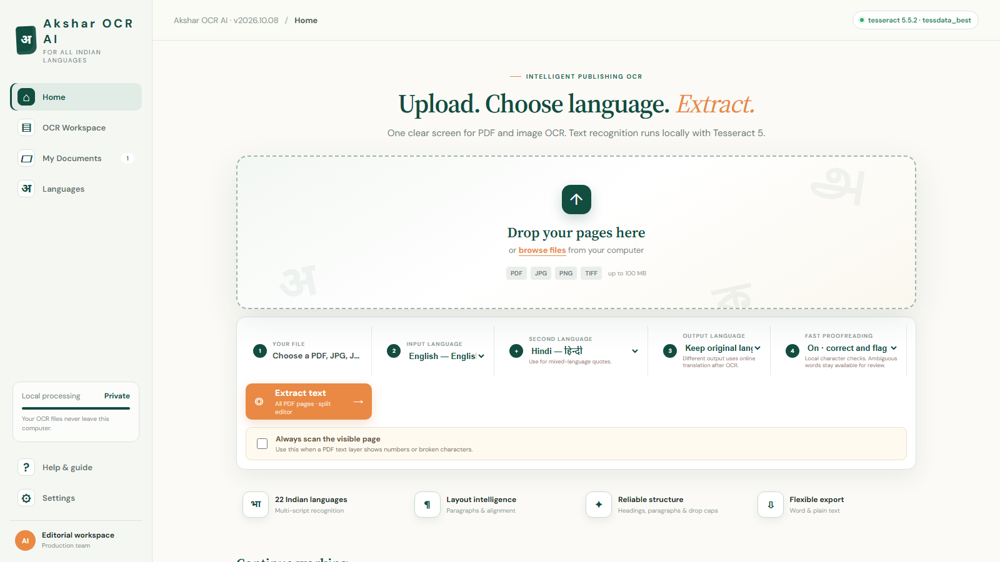

<div align="center">

<h1>🔤 Akshar OCR AI</h1>
<p><strong>The smartest offline OCR tool for all Indian languages — built on Tesseract & AI Kosh datasets</strong></p>



<p>
  <a href="https://github.com/UjjwalDS/akshar-ocr-ai/releases/latest">
    
  </a>
  <a href="https://github.com/UjjwalDS/akshar-ocr-ai/releases/latest">
    
  </a>
  
  
  
  
</p>

</div>

---

## 📖 Table of Contents
- [✨ What is Akshar OCR AI?](#-what-is-akshar-ocr-ai)
- [🚀 Features](#-features)
- [📸 Screenshots](#-screenshots)
- [⬇️ Download & Quick Start](#️-download--quick-start)
- [🌐 Supported Languages](#-supported-languages)
- [🧠 Under the Hood](#-under-the-hood)
- [📁 Project Structure](#-project-structure)
- [🔏 Privacy & Internet](#-privacy--internet)
- [⚙️ For Developers](#️-for-developers)
- [📝 Accuracy Notice](#-accuracy-notice)
- [📜 Third-Party Credits](#-third-party-credits)
- [🙌 Acknowledgements](#-acknowledgements)
- [📃 License](#-license)

---

## ✨ What is Akshar OCR AI?

**Akshar OCR AI** is a powerful, fully offline desktop OCR application built for **Indian language digitization**. Whether you're extracting text from scanned books, handwritten notes, PDFs, or images — Akshar handles it beautifully, with a rich built-in editor, word suggestions, and a side-by-side compare view.

> Built with ❤️ using **Tesseract OCR 5.5.2**, trained language datasets from **AI Kosh** and other open Indian language repositories — entirely running on your Windows PC. No cloud. No data upload. No subscription.

---

## 🚀 Features

### 📄 OCR & Extraction
- 📥 Upload **PDF, JPG, JPEG, PNG** files
- 🌍 Multi-language OCR — choose one or **multiple languages for bilingual pages**
- ⚡ Background page extraction — **edit completed pages while others are still processing**
- 🔬 Click any OCR word to **highlight its exact source region** in the original scan
- 🧩 Read Scan Region — drag a rectangle to OCR just that area

### ✏️ Built-in Rich Text Editor
- **Word-style ribbon toolbar** — Format, Paragraph, Insert, Page, OCR Settings, Preview Colours
- ✍️ Text formatting: bold, italic, underline, colour, alignment, lists, **drop caps**
- 📊 **Editable tables** — insert, resize, and format tables right inside the editor
- 🔤 **Word suggestions** — frequency-based suggestions to correct OCR errors quickly
- 🔁 Undo / Redo support

### 🖼️ Side-by-Side Compare View
- **Original scan vs. extracted text** — side by side or top/bottom layout
- Adjustable split divider — drag to resize panes
- Linked or independent scrolling
- Scan zoom, full screen mode, original-only or text-only layouts
- Preview colours — customise highlight colour, opacity, and background

### 📝 Indian Language Typing & Drawing
- **ITRANS phonetic input** — type in Roman script, get Devanagari/Tamil/Telugu output
- Google Input Tools integration for handwriting
- Experimental local drawing pad for character input
- Script-aware fonts for Tamil and Telugu

### 💾 Save, Resume & Export
- **Auto-save** by default (page-safe) — manual Ctrl+S supported
- Keeps **2 most recent projects** — fully resumable including source, edits, and page state
- **Bookmarks** — star pages and jump back anytime
- Export: **Word (.doc), TXT** — current page, selected pages, or all pages
- Page navigation with stable IDs to prevent cross-page mix-ups

### 🔍 Smart Proofreading
- Fast local **glyph confusion checks**: i/l/1/0/o/rn/m common OCR errors
- **Hindi punctuation flagging** — quotation marks, apostrophes, asterisks flagged for review
- Up to **4 image-based alternative candidates** per flagged word — pick, keep, undo or retype
- Flags are never auto-applied — human review always required

---

## 📸 Screenshots

> 📌 *Replace these placeholders with real screenshots before publishing*

| Side-by-Side Compare View | Rich Text Editor |
|:---:|:---:|
|  |  |

| Word Suggestions | Indian Language Typing |
|:---:|:---:|
|  |  |

| Table Editing | Bookmarks & Export |
|:---:|:---:|
|  |  |

---

## ⬇️ Download & Quick Start

### System Requirements
| | |
|---|---|
| **OS** | Windows 10 / 11, 64-bit |
| **RAM** | 8 GB recommended (more for high-resolution documents) |
| **Disk** | At least 1 GB free space |
| **Internet** | Not required for OCR *(first launch downloads extra language models on demand)* |

### Steps

1. Go to the **[Releases page](https://github.com/UjjwalDS/akshar-ocr-ai/releases/latest)**
2. Download `Akshar-OCR-AI-Windows.zip`
3. Right-click the ZIP → **Extract All**
4. Open the extracted folder and double-click **`Akshar-OCR-AI.exe`**
5. A startup window opens — your default browser will open automatically at `http://127.0.0.1:8890/`
6. Upload a PDF or image → Select language → Click **Extract Text**
7. Edit, proofread, and Export!

> **No Python, pip, or Tesseract installation required.** Everything is bundled in the EXE.

> ⚠️ The executable is unsigned. Windows SmartScreen may warn you on first run — click "More info → Run anyway". You can verify the file using the included `SHA256SUMS.txt`.

---

## 🌐 Supported Languages

| Language | Model Type | Status |
|---|---|---|
| English | Dedicated model (bundled) | ✅ Ready offline |
| Hindi / Devanagari | Dedicated model (bundled) | ✅ Ready offline |
| Tamil | Official Tesseract model (bundled) | ✅ Ready offline |
| Telugu | Official Tesseract model (bundled) | ✅ Ready offline |
| Other Indian languages | Script/language models | ⬇️ Downloaded on first use |

> All additional models are cached locally after first download.

---

## 🧠 Under the Hood

| Component | Version / Source |
|---|---|
| **OCR Engine** | Tesseract OCR 5.5.2 |
| **Language Training Data** | AI Kosh, Tesseract.js data packages, official Tesseract repos |
| **PDF Processing** | PDF.js 5.6.205 |
| **Transliteration** | Sanscript.js 1.3.3 |
| **Word Frequency Data** | wordfreq 3.1.1 (Robyn Speer) — CC BY-SA 4.0 |
| **Runtime** | Python (bundled, no install needed) |
| **Packaging** | PyInstaller |
| **UI** | HTML/CSS/JS served locally via Python server |

---

## 📁 Project Structure

```
Akshar-OCR-AI/
├── Akshar-OCR-AI.exe          # Main application (self-contained)
├── README.md                   # This file
├── OPEN-ME-FIRST.txt           # Quick start guide
├── GITHUB-GUIDE.md             # Developer/publishing guide
├── SHA256SUMS.txt              # Checksum for download verification
├── THIRD_PARTY_NOTICES.md      # Open-source licenses
└── licenses/                   # Full license texts
    ├── TESSERACT-APACHE-LICENSE.txt
    ├── PILLOW-LICENSE.txt
    ├── PYTHON-LICENSE.txt
    ├── SANSCRIPT-LICENSE.txt
    ├── WORDFREQ-LICENSE.txt
    └── WORDFREQ-SOURCES.txt
```

---

## 🔏 Privacy & Internet

| Feature | Online / Offline |
|---|---|
| OCR extraction | ✅ 100% offline |
| Word suggestions | ✅ 100% offline |
| Proofreading / glyph checks | ✅ 100% offline |
| Additional language model downloads | 🌐 First-time only, then cached |
| Optional output translation | 🌐 Google Translate endpoint (opt-in) |
| Handwriting (Google Input Tools) | 🌐 External — data stays on Google's site |

> Your scans and documents are **never uploaded** to any server during OCR.

---

## ⚙️ For Developers

### Running from Source

```bash
# Requirements: Python 3.10+, Windows
pip install -r requirements.txt
python server.py
```

- Provide `ocr-engine/tesseract.exe` and models in `tessdata/`, or install Tesseract separately.
- Visit `http://127.0.0.1:8890/` in your browser.

### Building the EXE

```bash
pip install pyinstaller
pyinstaller --noconfirm Akshar-OCR-AI.spec
# Output appears in dist/
```

> Review third-party license obligations before redistributing.

### What's in `.gitignore`
- Executables and model binaries (`*.exe`, `*.traineddata`)
- Archives (`*.zip`)
- Private document formats
- Generated/cache files

---

## 📝 Accuracy Notice

> **95% average accuracy (English/Hindi) is a target, not an independently benchmarked result.**

OCR accuracy depends heavily on:
- Scan quality and resolution
- Document layout complexity
- Language(s) selected

Always **proofread before publishing**. OCR confidence scores are not accuracy percentages.

**Tips for best results:**
- Use upright, clear, high-resolution scans
- Select only the languages actually present on the page
- Use "Always scan the visible page" if a PDF text layer gives garbled output

---

## 📜 Third-Party Credits

This project is built on top of amazing open-source work:

| Library | License |
|---|---|
| [Tesseract OCR](https://github.com/tesseract-ocr/tesseract) | Apache 2.0 |
| [Tesseract.js](https://github.com/naptha/tesseract.js) | Apache 2.0 |
| [PDF.js](https://github.com/mozilla/pdf.js) | Apache 2.0 |
| [Sanscript.js](https://github.com/indic-transliteration/sanscript.js) | MIT |
| [wordfreq](https://github.com/rspeer/wordfreq) | Apache 2.0 (code) / CC BY-SA 4.0 (data) |
| [Pillow](https://github.com/python-pillow/Pillow) | HPND |
| [Python](https://www.python.org/) | PSF License |

Full license texts are included in the `licenses/` folder and `THIRD_PARTY_NOTICES.md`.

---

## 🙌 Acknowledgements

- **[AI Kosh](https://ai4bharat.iitm.ac.in/)** and other Indian language AI datasets for training data
- **[Tesseract OCR](https://github.com/tesseract-ocr/tesseract)** — the backbone OCR engine
- **[AI4Bharat](https://ai4bharat.iitm.ac.in/)** community for Indian language NLP resources
- All open-source contributors whose libraries made this possible

---

## 📃 License

The **source code** of Akshar OCR AI is released under the **[Apache License 2.0](LICENSE)**.

Third-party components retain their respective licenses (see `THIRD_PARTY_NOTICES.md`).

---

<div align="center">
  <p>Made with ❤️ for Indian language digitization</p>
  <p>⭐ If this project helped you, please star it on GitHub!</p>
</div>
